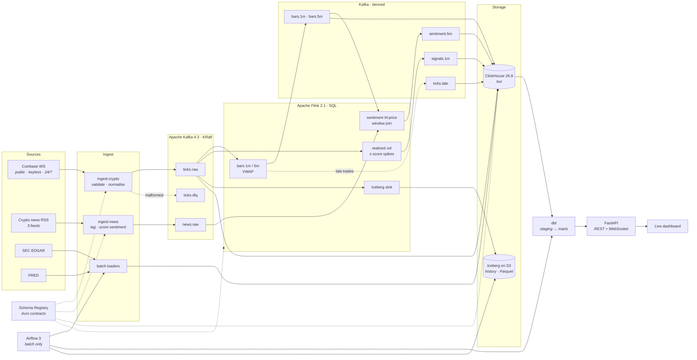
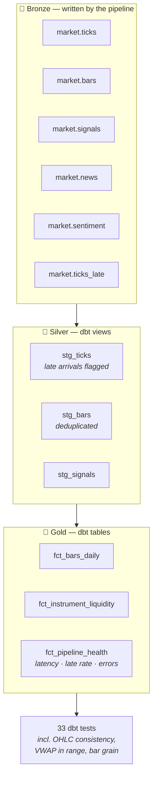

# Real-time market data pipeline

A streaming data platform for market data: a live trade feed into Kafka, processed
on **event time** with watermarks, landed in both a hot store and a lakehouse,
modelled with dbt, orchestrated with Airflow, and instrumented well enough to
answer *"how late is it, and is anything falling behind?"*

Built originally in 2021 on Kafka 2.3 + ZooKeeper, Cassandra and Bokeh.
Rebuilt from the ground up — the decisions and their reasons are in
[`docs/adr/`](docs/adr/).

```bash
just install && just up
just ingest   # live Coinbase feed
just stream   # Flink SQL jobs
just api      # → http://localhost:8000
```

---

## Architecture



## The idea that shapes everything: event time

Phase 1 of the rebuild aggregated bars from stored ticks **at query time**. That
means a "bar" was whatever had arrived when you asked — re-run the query a minute
later and a bar for a ten-minute-old window could still change. Nothing
downstream could know whether it was looking at a settled number.

Now bars are closed by a **watermark**, and a late trade is recorded rather than
silently folded into a number someone already acted on.

```mermaid
sequenceDiagram
    participant V as Coinbase
    participant K as Kafka
    participant F as Flink
    participant C as ClickHouse

    Note over F: window [10:00, 10:01)
    V->>K: trade @ 10:00:12
    K->>F: event_time 10:00:12
    V->>K: trade @ 10:00:58
    K->>F: event_time 10:00:58
    Note over F: watermark = max(event_time) − 5s

    V->>K: trade @ 10:01:04
    K->>F: watermark passes 10:01:00
    F->>C: emit bar [10:00,10:01) — final
    Note over C: bar is settled; it will not change

    V->>K: trade @ 10:00:45 (arrives late)
    K->>F: event_time < watermark
    F->>C: → ticks.late (lateness recorded)
    Note over C: the closed bar is NOT mutated
```

`stream/tests/late_data_check.py` proves it: it injects a trade behind the
watermark and asserts it lands in `ticks_late`, that the targeted closed bar's
trade count is unchanged, and that its sentinel price never reaches that bar.

`stream/tests/bar_reconciliation.py` recomputes **every settled window the
running job produced** from stored ticks — anti-joining known late arrivals —
and asserts it matches what Flink emitted, field for field. It asks Flink when
its bars job started, so it compares only windows that job saw start to finish:
a window a job joined part-way through is incomplete by construction and not
comparable.

## Data layers



`fct_pipeline_health` is the one worth a look: throughput, latency percentiles,
late-arrival rate and decode failures **per day, queryable**. Most projects can
tell you what the data says; rather fewer can tell you how late it was.

---

## What's interesting here

| | |
|---|---|
| **Nothing fabricates a price** | The 2021 version published an `np.random.uniform` walk to the *real* topic outside trading hours, indistinguishable from real data. The feed is now crypto — free, keyless, 24/7 — so the demo is live whenever you open it. |
| **Contracts are load-bearing** | Avro schemas in [`contracts/`](contracts/) are registered on first write; the registry rejects an incompatible change at the producer, not in production. |
| **Two stores, one stream** | ClickHouse (hot) and Iceberg (history) are written from the same stream, so neither is the other's cache and a failure in one can't corrupt the other. |
| **The pipeline measures itself** | Every tick carries the venue's clock and ours; the difference is end-to-end latency, on the dashboard and in Grafana. |
| **Streaming correctness is tested** | Not "it runs" — a late-data proof and a full reconciliation against an independent replay. |
| **SLOs are rules, not prose** | Five Prometheus alerting rules. A rule fires, which means it can be wrong, which means it gets fixed. |

### Sentiment × price

The most technically involved piece: a **stream-to-stream window join** between
news sentiment and price bars, each with its own watermark, aligned on the same
5-minute event-time windows ([`stream/sql/40_sentiment.sql`](stream/sql/40_sentiment.sql)).

It's an INNER join on purpose — most windows have trades but no news, and a row
claiming "sentiment 0.0" for a window where nothing was published would be a
fabricated reading, not a neutral one.

Scoring is pluggable: **VADER** by default so the project runs for anyone who
clones it, **Claude** when `ANTHROPIC_API_KEY` is set. The comparison is the
point — same pipeline, same windows, and you can see where a lexicon falls down
on financial language.

---

## Quickstart

Needs Docker, [`uv`](https://docs.astral.sh/uv/) and [`just`](https://just.systems).

```bash
just install          # sync the uv workspace
just up               # the whole stack, with health gates
just ingest           # Coinbase feed          (leave running)
just stream           # submit the Flink jobs
just api              # dashboard              (leave running, another shell)
just news             # news + sentiment       (optional)
```

| | |
|---|---|
| Dashboard | <http://localhost:8000> |
| Grafana | <http://localhost:3000> |
| Prometheus | <http://localhost:9090> |
| Jaeger | <http://localhost:16686> |
| Flink | <http://localhost:8081> |
| Airflow | <http://localhost:8082> |
| ClickHouse | <http://localhost:8123/play> |

```bash
just verify     # streaming correctness: late-data proof + bar reconciliation
just dbt-build  # build and test the marts
just test       # unit tests
just lint       # ruff + mypy --strict
just down       # tear down, including volumes
```

`just verify` is the interesting one.

---

## Layout

```
contracts/      Avro schemas — the source of truth for the wire format
services/       ingest_crypto · ingest_news · api · batch
stream/         Flink SQL jobs, and the correctness checks for them
warehouse/      dbt: staging views, marts, 33 tests
orchestration/  Airflow 3 DAGs — batch only
libs/           mdp_core: config, logging, contracts, tracing
infra/          ClickHouse schema, Flink/Airflow images, Prometheus, Grafana
docs/adr/       why things are the way they are
```

## Stack

Python 3.14 · Apache Kafka 4.3 (KRaft) · Confluent Schema Registry · Apache
Flink 2.1 (SQL) · ClickHouse 26.9 · Apache Iceberg (REST catalog, S3) · dbt ·
Apache Airflow 3.3 · FastAPI · Prometheus · Grafana · Jaeger / OpenTelemetry

## Roadmap

| Phase | Scope | Status |
|---|---|---|
| 1 | Streaming skeleton: feed → Kafka → ClickHouse → live chart | **done** |
| 2 | Flink SQL: event-time bars, VWAP, volatility, watermarks, late data | **done** |
| 3 | Iceberg lakehouse, dbt marts, SEC EDGAR + FRED, Airflow 3 | **done** |
| 4 | Prometheus + Grafana, OpenTelemetry traces, SLO rules | **done** |
| 5 | Sentiment × price window join, integration tests, docs | **done** |
| 6 | Hosted public demo | next |

## Decision records

Short records of what was chosen and — more usefully — what was rejected:
[`docs/adr/`](docs/adr/). A few worth reading on their own:

- [0009 — Watermarks, and what happens to trades that miss them](docs/adr/0009-watermarks-and-late-data.md)
- [0013 — ClickHouse left joins have no NULLs](docs/adr/0013-clickhouse-left-join-has-no-nulls.md) (a bug that reported a 100% late rate)
- [0012 — Iceberg on S3-compatible storage](docs/adr/0012-iceberg-on-s3-compatible-storage.md)
- [0011 — open/close rest on a stated invariant, not an ORDER BY](docs/adr/0011-ohlc-open-close-ordering.md)

## Licence

[LICENSE](LICENSE)
